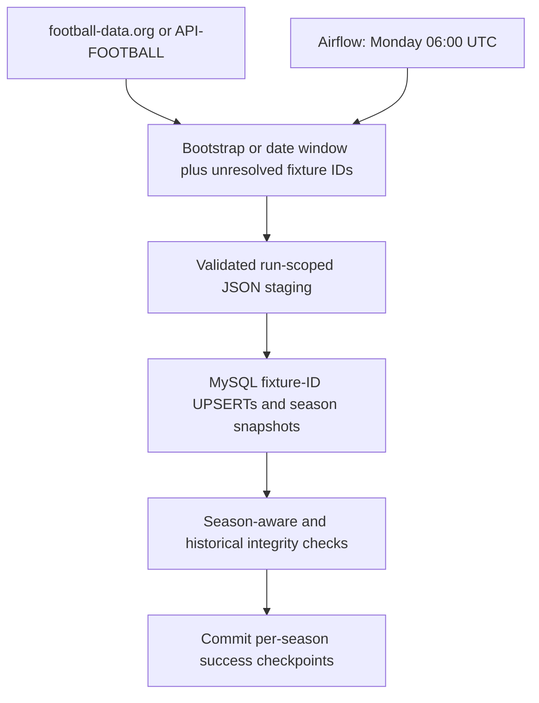

# Premier League Data Engineering Pipeline

A scheduled, incremental Premier League ETL project built with Python, Pandas, football-data.org, API-FOOTBALL, MySQL, Apache Airflow 3.3.1, Docker Compose, pytest, and GitHub Actions.

The project preserves its **2024–25 archive** and supports weekly updates for **2026–27** (`season=2026` in the API). Fixtures are inserted or updated by `fixture_id`; reruns do not append duplicates or delete archived records.

[Repository](https://github.com/Mohamed254-pixel/premier-league-data-pipeline) · [Architecture](docs/architecture.md) · [Data model](docs/data-model.md) · [Migration and recovery](docs/phase2-migrations.md)

**Phase 3 AWS demo — verified November 11, 2026 UTC:** CloudFormation deployed a time-boxed EC2 demo in Ohio. Docker runs Airflow 3.3.1 with LocalExecutor, PostgreSQL metadata, and an isolated MySQL application database. The manual-only five-task DAG completed the first cloud ingestion (380 current-season fixtures) and one supervised repeat (30 reprocessed, no new or changed fixtures). Historical fixtures remained unchanged, checkpoints advanced after validation, and S3 archives were verified. The demo DAG is paused, and EC2 is verified stopped. See the [demo runbook](deploy/aws/demo/README.md) and [verified AWS evidence](docs/portfolio/phase3/README.md).

**Phase 2 activation record — 7 November 2026 UTC:** The local pipeline passed deployment and scheduling checks. Migrations **003/004**, [service startup](docs/phase2-service-startup.md), [real bootstrap](docs/phase2-bootstrap-results.md), [incremental repeat](docs/phase2-repeat-results.md) and [approved scheduling activation](docs/phase2-scheduling-results.md) passed. MySQL holds **380 archived 2024 fixtures plus 380 season-2026 fixtures** (91 completed, 289 scheduled). The first scheduler-created run passed all five tasks on their first attempts, rechecking 36 fixtures without duplicates or business-value changes. All seven persistent services are healthy; merged-main CI passed the full 295-test integration suite. At activation, the DAG was enabled and its next scheduled slot was November 9 at 06:00 UTC. Current local Airflow service health and later run outcomes have not been verified.

The earlier [engineering review](docs/engineering-review.md) and [activation investigation](docs/phase2-activation.md) remain dated records. Their Fernet and administrator-access blockers are resolved. The historical API-FOOTBALL Free-plan restriction is avoided by selecting the authorized football-data.org source. All real runs used existing credentials; no subscription purchase or credential disclosure was involved.

The [football-data.org adapter](docs/football-data-source.md) supplies 2026–27 while preserving API-FOOTBALL and separate provider identities. The supervised bootstrap and repeat used the existing runner inside the worker container. Separately approved scheduling activation then completed a real Airflow DAG run through all five tasks.

## Scope and current data

| Dataset | Matches | Teams | Venues |
| --- | ---: | ---: | ---: |
| Committed 2024–25 archive | 380 | 20 | 20 |
| Loaded 2026–27 season | 380 fixtures: 91 completed, 289 scheduled | 20 memberships | No stable venue IDs supplied |

The three original CSVs under `data/` remain unchanged. Phase 2 stages new batches under ignored `data/staging/`, not in the archive files. Existing canonical team and venue records remain unchanged; current descriptions are stored in season snapshots. Global team/venue counts can grow as clubs change between seasons.

Phase 1 was merged in PR #5; Phase 2 PRs #6, #7 and #8 are merged. The repository was renamed without losing history. Migrations, service startup, bootstrap, repeat-run testing and weekly scheduling were separately approved and verified. Main commit `381747c` is the activated code version. This is a Mac-hosted deployment: MySQL, Docker Desktop and the Airflow services must stay running, and the Mac must remain awake.

## Architecture



Both execution paths preserve this five-task order:

```text
extract_matches
  → extract_teams_and_venues
  → load_teams_and_venues
  → load_matches
  → validate_data_quality
```

Airflow uses `schedule="0 6 * * 1"`, UTC, `catchup=False`, two retries five minutes apart, and `max_active_runs=1`. Tasks have a one-hour execution timeout; cancellation terminates their child processes. Manual triggering remains available. A database run-owner guard also prevents a local runner from racing Airflow. Child stdout/stderr and failures remain visible in task logs.

## Incremental strategy

1. Bootstrap each configured season once using its complete fixture list.
2. On later runs, fetch from the last successful checkpoint minus a configurable overlap (default 14 days) through the next 14 days. The range widens after missed runs.
3. Independently recheck overdue scheduled fixtures and uncertain/postponed/interrupted fixtures by ID, in batches of at most 20. Their original date can be outside the window.
4. Reconcile the configured season in full every 28 days by default. This catches moved fixtures and older corrections that a date filter cannot reveal. The archived 2024 season is never automatically re-downloaded.
5. Commit checkpoints only after the final quality step succeeds. A valid empty incremental window is a no-op; an empty bootstrap, API error, malformed response, or incomplete ID lookup fails the run.

Idempotency preserves fixture identities and business values. Reobserved fixtures receive a newer `source_observed_at`, and a successful incremental run advances `last_success_at` even if dates, teams, scores and statuses are unchanged. `last_full_sync_at` advances only for a full reconciliation. The real repeat verified zero business-value changes and 36 observation-only updates; it was not a claim of zero SQL writes.

Full reconciliation must include every previously stored fixture ID for that season. Missing results fail before publishing the batch. Transport failures and transient HTTP errors retry up to three attempts with bounded backoff; authentication, subscription, and malformed-data failures require intervention or a later task retry.

This is a weekly refresh, not a real-time scores service. Live scores/statuses are captured when a run polls them. Older corrections may wait until the next full active-season reconciliation. See the [API-FOOTBALL fixtures contract](https://www.api-football.com/documentation_v3).

## Local setup

Use Python 3.11+ and MySQL 8.0.16+ for enforced CHECK constraints. Docker Desktop is needed for Airflow, but not for offline tests or the local runner. Local verification used MySQL 9.3.0; CI uses MySQL 8.0.

```bash
git clone https://github.com/Mohamed254-pixel/premier-league-data-pipeline.git
cd premier-league-data-pipeline
python3 -m venv .venv
source .venv/bin/activate
python -m pip install -r requirements-dev.txt
cp -n .env.example .env
```

Fill in the private API/MySQL values in `.env`. Never commit it. The required application permissions remain `SELECT`, `INSERT`, `UPDATE`, and `DELETE`; schema changes use a separate administrator connection.

Important settings:

```dotenv
FOOTBALL_LEAGUE_ID=39
FOOTBALL_SEASONS=2026
FOOTBALL_SOURCE=football_data
INCREMENTAL_OVERLAP_DAYS=14
FULL_RECONCILE_DAYS=28
```

`2026` means the 2026–27 season. A comma-separated value such as `2025,2026` supports multiple update seasons. `2024` is protected and is rejected as an update season. The older `FOOTBALL_SEASON=2024` setting is retained for legacy snapshot helpers; it does not select the incremental refresh season. Optional `PIPELINE_ENV_FILE` points to a private environment file outside the checkout.

To use the new provider after migration approval, set `FOOTBALL_SOURCE=football_data` and `FOOTBALL_DATA_API_KEY` in the private environment. API-FOOTBALL continues to use `API_KEY`. Tokens are never interchangeable and no automatic provider fallback occurs. Migration 004 registers source-specific IDs after migration 003; review its [schema and activation instructions](docs/football-data-source.md) before applying it. Existing populated seasons cannot be switched automatically between providers.

### Prepare the existing database

Review [migrations and rollback guards](docs/phase2-migrations.md) and the [current approval plan](docs/phase2-activation-status.md) before running ETL. Back up the database outside Git, pause the DAG, and use an administrator environment file. The first command is read-only; execute either `--apply` command only after migration approval:

```bash
PIPELINE_ENV_FILE=/private/path/admin.env python scripts/migrate_phase2.py
PIPELINE_ENV_FILE=/private/path/admin.env python scripts/migrate_phase2.py --apply
PIPELINE_ENV_FILE=/private/path/admin.env python scripts/migrate_sources.py
PIPELINE_ENV_FILE=/private/path/admin.env python scripts/migrate_sources.py --apply
```

Migration 003 requires the verified original archive and adds season/status metadata and supporting tables. Migration 004 then adds provider-ID mappings and collision constraints. Both preserve original values and IDs and are never applied automatically by ETL. The 004 preflight requires 003 to have completed first.

For a fresh empty installation, first run the existing `sql/schema.sql` with an administrator and load the committed archive using the existing CSV helpers, then run migration 003:

```bash
# Only for initialising an empty database, before migration 003:
PYTHONPATH=scripts python -c 'from load_teams import main; main(); from load_live_matches import main; main()'
```

Do not use legacy CSV helpers to operate a multi-season database. Normal script entrypoints and the runner use the incremental stages.

### Run the pipeline

With both migrations applied, application credentials configured, and ingestion approved:

```bash
python run_pipeline.py
```

Every step logs its start, success/failure, and duration. Any failure stops downstream steps and exits nonzero. The runner prints a run ID for recovery. Original archive CSVs remain unchanged.

With the existing stack configured, the equivalent container command uses its application credentials and shared staging volume:

```bash
# Write-capable: requires approval in this deployment.
docker compose --project-name soccer-data-pipeline --env-file /private/path/runtime.env \
  exec -T airflow-worker python /opt/soccer/run_pipeline.py
```

Pause the enabled DAG and verify no active tasks or pending pipeline owner before an approved supervised runner execution. Do not manually trigger a paused DAG expecting scheduler execution. The initial scheduler-created run has now passed; subsequent weekly runs still need monitoring.

## Docker and Airflow

The existing private `FERNET_KEY` and independent `AIRFLOW__API_AUTH__JWT_SECRET` are validated. Preserve them and the original metadata backups. For a new installation only, generate the Fernet key with `cryptography.fernet.Fernet.generate_key()` and an independent JWT secret with `secrets.token_urlsafe(48)`, writing directly to a protected private file rather than printing them. Existing encrypted metadata requires a separately reviewed key-recovery/rotation procedure. Compose refuses missing keys; UI ports bind to loopback. This stack retains local development metadata credentials and requires further access/security configuration before hosting publicly.

Run read-only checks before requesting activation approval:

```bash
COMPOSE_PROJECT_NAME=soccer-data-pipeline python scripts/check_readiness.py --env-file /private/path/runtime.env --api
```

This reads database integrity, Docker/Compose/service health, and small API entitlement probes; it consumes API quota but never starts services, migrates, stages data, or ingests fixtures. Exit zero requires all checks, including running healthy Airflow services, to pass. Before migration/startup, a nonzero result is expected. Omit `--api` to avoid HTTP probes; API readiness then remains unverified and the command exits nonzero.

Use the existing Compose project name to preserve the original metadata and staging volumes, even from a renamed checkout or worktree. Set these nonsecret paths before checking configuration:

```bash
export COMPOSE_PROJECT_NAME=soccer-data-pipeline
export ENV_FILE_PATH=/private/path/runtime.env
export AIRFLOW_PROJ_DIR=/path/to/existing/runtime-checkout
docker compose --env-file "$ENV_FILE_PATH" config --quiet
```

Point `AIRFLOW_PROJ_DIR` at the existing checkout whose config, logs and plugins must be preserved; verify its runtime source matches the reviewed code. A worktree may lack those ignored directories. **After service-start approval**, start Docker Desktop and build/start the stack in stages. Verify original metadata is current, the DAG is paused, and no active or queued work exists before scheduler/worker startup. Never reset metadata or volumes.

For this existing environment, metadata and user setup are already current, so `airflow-init` was deliberately skipped. That one-shot service performs metadata migrations/user setup and is not a sixth persistent Airflow process. Initialization of a new or outdated environment requires separate review and approval. The verified existing-environment sequence is:

```bash
docker compose --env-file "$ENV_FILE_PATH" build
docker compose --env-file "$ENV_FILE_PATH" up -d --no-deps postgres redis
# Verify metadata version, paused DAG, empty task/run state and broker first.
docker compose --env-file "$ENV_FILE_PATH" up -d --no-deps airflow-apiserver airflow-dag-processor airflow-triggerer
# Verify prerequisite health, paused DAG and empty queues again.
docker compose --env-file "$ENV_FILE_PATH" up -d --no-deps airflow-scheduler airflow-worker
docker compose --env-file "$ENV_FILE_PATH" ps
docker compose --env-file "$ENV_FILE_PATH" exec airflow-scheduler airflow dags list-import-errors
```

Open [Airflow](http://localhost:8080). The existing local development defaults are `airflow` / `airflow`; these are not production credentials. Keep the DAG paused until supervised ingestion and a separately approved repeat-run check both pass. **Only after scheduling approval**, unpause it:

```bash
docker compose --env-file "$ENV_FILE_PATH" exec airflow-scheduler airflow dags unpause premier_league_etl
```

Check tasks and runs:

```bash
docker compose --env-file "$ENV_FILE_PATH" exec airflow-scheduler airflow tasks list premier_league_etl
docker compose --env-file "$ENV_FILE_PATH" exec airflow-scheduler airflow dags list-runs premier_league_etl
docker compose --env-file "$ENV_FILE_PATH" logs --tail 100 airflow-scheduler airflow-worker airflow-dag-processor
```

The Mac must remain powered on and awake, with Docker Desktop, MySQL, scheduler, and workers running. This is a local deployment, not an always-on cloud service. Airflow tasks use the same run ID across all five stages. MySQL remains on the Mac host via `host.docker.internal`; PostgreSQL/Redis serve Airflow only. The existing named data volume is retained for staging. A separate read-only mount exposes the committed archive at `/opt/soccer/historical-data`, so an empty staging volume cannot hide it.

`docker compose down` stops the services while retaining volumes. Do not remove named volumes as part of routine operation.

Before stopping, confirm no run owns `pipeline_control`. Restart with the staged existing-metadata commands above, preserving project name, keys, mounts and pause state. Do not use service restart as a reason to rerun ETL or release a pending owner automatically.

For MySQL Workbench, use the existing private connection and query by `season`, not the global table count:

```sql
SELECT season, COUNT(*) AS fixtures FROM live_matches GROUP BY season;
SELECT season, status_short, COUNT(*) AS fixtures
FROM live_matches GROUP BY season, status_short;
SELECT season, COUNT(*) AS teams FROM season_teams GROUP BY season;
SELECT * FROM season_sync_state;
```

Backups stay outside Git with restrictive permissions. Use a new timestamped filename, a consistent InnoDB snapshot, checksum verification and restoration on an isolated compatible server. The [pre-repeat backup](docs/phase2-repeat-results.md) includes all 15 tables and both seasons. Never restore over the application database or remove source data to force a migration rollback without a separately approved recovery plan.

## Validation and tests

Validation checks the original historical match/team/venue values against their committed CSVs, fixture identities, classification/status fields, final-score completeness, and 20 team memberships per configured season. Current-season fixture counts may be incomplete, up to the Premier League's 380 fixtures. There is no global requirement that the database contain exactly 380 matches or 20 teams. Foreign keys enforce fixture-to-season-team and venue relationships.

Scheduled and postponed fixtures may have null scores; finished `FT`, `AET`, and `PEN` fixtures require both scores. Unknown kickoff times are allowed only for `TBD` and `PST`. Cancelled, abandoned, technical-loss, and walkover statuses are retained without fabricating scores.

```bash
python -m pytest
```

The default suite uses mocked API/database boundaries and needs no API credentials or MySQL server. Real MySQL tests are opt-in and create only randomly named disposable test databases. For an explicitly designated test server:

```bash
PIPELINE_TEST_MYSQL_HOST=127.0.0.1 \
PIPELINE_TEST_MYSQL_PASSWORD=your_disposable_test_password \
python -m pytest
```

For an isolated local server with networking disabled, set `PIPELINE_TEST_MYSQL_SOCKET` instead. Never point the test environment at an application account. The suite verifies migration up/down/resume, inserts and corrections, postponed fixtures, repeated runs, multiple seasons, duplicate/unique-key protection, failure handling, archive preservation, and the complete five-stage flow with a mocked API and real MySQL.

[GitHub Actions](.github/workflows/tests.yml) runs Python 3.11 tests on pushes and pull requests to `main`. A second job runs the full suite against an ephemeral MySQL 8.0 service. A third imports the actual Airflow 3.3.1 DAG and verifies task dependencies, schedule, retries, and timeouts with `python scripts/check_dag.py`. Its test-only database password is not an application secret. No API key or application credentials are needed.

## Recovery and troubleshooting

- **Missing migration/table:** run the read-only preflight and obtain approval for 003 followed by 004 when using football-data.org. The ETL never creates or alters tables.
- **API key/quota/current-season access:** check the dashboard for the configured provider. football-data.org uses `FOOTBALL_DATA_API_KEY`; API-FOOTBALL uses `API_KEY`. A configured key does not prove season access. API errors fail the run without publishing a fixture batch or advancing its checkpoint. Error payloads/credentials are not echoed.
- **Another run is pending:** resume the same run ID rather than starting an overlapping run. The six-hour run-owner lease prevents permanent blockage after a dead process; a later extraction can replace an expired owner and fences out its old worker. After stopping any old worker, retry locally with `PIPELINE_RUN_ID=the_original_run_id python run_pipeline.py`. Airflow retries already reuse the same ID.
- **Abandoned or invalid frozen batch:** stop its workers, then explicitly release the owner with `python scripts/incremental.py release-run the_original_run_id`. Start a new run ID to refetch. Releasing does not delete records or advance checkpoints.
- **Quality failure:** inspect task logs. Transactions are per loader; a later quality failure does not undo committed loads. It keeps the checkpoint unchanged and the owner pending so a retry can validate the same data. UPSERTs make repeated loads safe.
- **Historical mismatch:** stop and investigate; never fix it by overwriting the archive to match the database. Compare the trusted committed CSVs and your backup.
- **Weekly run absent:** confirm the DAG is unpaused, the services are healthy, and no previous run is active. The schedule is UTC and its local time changes with daylight saving time.
- **Docker unavailable:** offline tests still work. A syntax-only Compose check needs no secrets or daemon:

```bash
python scripts/check_readiness.py --compose-example
```

Run-scoped staging is retained for retries and audit. Archive old completed staging files only after confirming no active run needs them. Do not edit a pending batch; release it and start a fresh run instead.

## Project layout

```text
dags/soccer_pipeline_dag.py          # Same five tasks and weekly UTC schedule
run_pipeline.py                    # Local execution and per-step logging
scripts/incremental.py             # API parsing, planning, staging, stage dispatch
scripts/season_store.py            # Transactional loading, run guard, checkpoints
scripts/migrate_phase2.py          # Explicit guarded migration/preflight
scripts/api_*.py, load_*.py        # Stage entrypoints and archive helpers
sql/schema.sql                     # Original Phase 1 schema, unchanged
sql/migrations/003_*.sql            # Additive metadata and guarded down migration
data/*.csv                         # Original 2024 snapshots, unchanged
data/staging/                      # Ignored run manifests
tests/                             # Offline tests and opt-in MySQL integration tests
.github/workflows/tests.yml         # Python 3.11 and MySQL 8.0 CI
scripts/football_data.py            # football-data.org HTTP adapter and parsing
scripts/source_ids.py               # Provider namespaces and identity registry
scripts/migrate_sources.py          # Explicit migration 004 preflight/apply/rollback
```

## Future work

AWS S3/RDS, dbt, additional football datasets, monitoring/alerts, and dashboards remain future work. AWS, Kafka, Spark, and dbt are not implemented in Phase 2.

Licensed under [MIT](LICENSE).
