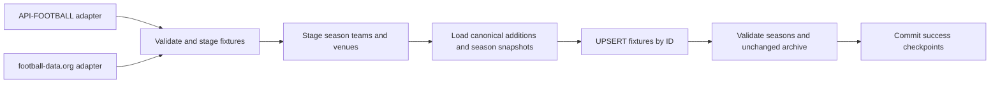

# Premier League Data Engineering Pipeline — Architecture

The merged implementation has verified migrations, healthy local services, a real season-2026 bootstrap and [one successful incremental repeat](phase2-repeat-results.md). The DAG remains paused; weekly scheduling is pending approval. The runtime selects football-data.org for season 2026, while the code retains API-FOOTBALL as its compatibility default. Both supervised runs used the deployed runner, not Airflow DAG task execution.

## Scope

Phase 2 extends the existing five-stage pipeline with incremental fixture updates and explicit season identity. It preserves the committed 2024–25 snapshot and defaults to refreshing 2026–27. API season identifiers are starting years; multiple update seasons are configurable. League 39 is enforced.

The [football-data.org follow-up](football-data-source.md) adds `FOOTBALL_SOURCE=football_data` while retaining `api_football` as the default. Both adapters share staging, transactional loaders, validation, ownership, and checkpoints. Canonical Premier League identity is fixed, mapped from API-FOOTBALL league 39 or football-data.org competition PL/2021. Migration 004 separates provider IDs and binds each season to one source. Do not mix provider namespaces or automatically switch an existing season.

## Execution and data flow

The original task names remain: `extract_matches`, `extract_teams_and_venues`, `load_teams_and_venues`, `load_matches`, `validate_data_quality`. Their dependency chain is unchanged. Existing script command-line entrypoints dispatch to `incremental.py`; original parsing and CSV preparation helpers remain for archive compatibility and regression tests. Direct legacy CSV-loading functions are not the scheduled workflow.

`run_pipeline.py` generates one local run ID and calls the five script entrypoints. Each Airflow task supplies the same DAG run ID through `PIPELINE_RUN_ID`. Both paths fail on child errors and log step durations. Airflow runs Monday at 06:00 UTC, retains two retries five minutes apart, disables catchup, permits manual triggers, and limits active DAG runs to one.

## Extraction strategy

A new season has no successful checkpoint, so its fixture list is bootstrapped once. Later runs request the date range from `last_success_at - overlap` through two weeks ahead. Missing weekly runs widen this range automatically. Default overlap is 14 days.

The planner additionally rechecks uncertain fixtures by ID regardless of date: TBD, postponed, suspended, interrupted, abandoned/cancelled, live periods, and overdue scheduled fixtures. ID lists are bounded to the documented 20-fixture limit. A periodic full reconciliation of configured seasons (28 days by default) catches older corrections and fixtures moved across the window. The 2024 archive cannot be selected for refreshing.

For football-data.org, bootstrap/full reconciliation requests `/v4/competitions/PL/matches?season=2026`. Incremental windows use `dateFrom`/`dateTo`; unresolved fixtures absent from that window are fetched individually at `/v4/matches/{raw_source_id}`. The adapter checks result counts, league/season identity, known fixture coverage, and all source-to-canonical IDs. A client spaces calls by at least 6.1 seconds, reads remaining/reset headers, and bounds retries for 429/5xx/transport failures. Longer provider waits fail for a later Airflow retry. Both credentials are headers, never query parameters.

API-FOOTBALL does not document an updated-since filter for fixtures, so a date window alone is insufficient. References: [fixtures documentation](https://www.api-football.com/documentation_v3), [official league extraction examples](https://www.api-football.com/news/post/how-to-get-all-data-from-a-league-with-api-football).

API responses must have the expected shape, matching result count when supplied, no reported errors, and no unexpected pagination. Each fixture must match the requested league and season. Empty date windows are valid no-ops; empty bootstrap/reconciliation and missing requested fixture IDs are failures. Duplicates within a single API response are rejected. A later explicit-ID observation supersedes an earlier window observation of the same fixture, which accommodates live state changing between HTTP calls.

Full reconciliations additionally require all known stored fixture IDs to be returned. The team extraction stage checks fixture team IDs against the requested season's memberships before loading. HTTP timeouts/connection failures and 429/500/502/503/504 retry at most three attempts. Backoff honors Retry-After up to 30 seconds; longer waits propagate to the task retry. Permanent API errors are classified without echoing provider/account error values. Database connections have explicit connect/read/write timeouts.

Weekly refresh is not real-time ingestion. Corrections outside the overlap can take until the next reconciliation to appear. Current-season subscription coverage must be checked before a live bootstrap; having a key alone is not sufficient.

## Staging and retries

A hashed run ID selects an ignored JSON manifest in `data/staging/`. It contains the requested seasons, observation timestamp, plan, fixture records, team snapshots, and last successful stage. The completed extraction is atomically published only after validation, using a temporary file and rename. Files never replace `data/live_matches.csv`, `data/teams.csv`, or `data/venues.csv`.

Retries use the frozen batch for the same run ID. They do not combine freshly fetched matches with already loaded teams. Stage markers are written after a database commit, so a process dying between the commit and marker write retries an idempotent load. Final checkpoint commits also remember the completed run ID to make that retry safe.

An OS file lock serializes each manifest's stage operations. The database claim persists the observation timestamp before extraction; an extraction retry before manifest publication reuses it. Airflow tasks time out after one hour, terminate their child on cancellation, and retain the existing five-minute retry delay. The six-hour database lease remains longer than normal task execution. This is designed for the existing shared local Docker volume, not distributed object-store locking.

Manifests must match the run ID, requested seasons, and version. Fixtures are revalidated before SQL preparation. Unknown future statuses fail explicitly rather than becoming an invented final result.

## Database storage and historical protection

The original three tables remain. `fixture_id` is still the match primary key and UPSERT identity. New match metadata includes season, status, elapsed time, source team IDs, and the source observation timestamp. Unknown kickoff dates are nullable only for TBD/postponed data. Historical fixture/date/name/score values stay unchanged.

MySQL applies UPSERT on any unique-key collision, not just the primary key. The loader therefore checks the existing date/home/away constraint and duplicates in the incoming batch before executing UPSERTs. It rejects different fixture IDs colliding on that alternate key, cross-season ID reassignment, writes to the protected archive, and older observations.

Canonical team and venue rows are inserted only when new; existing descriptions are retained. `season_teams` records membership and JSON descriptions/venue snapshots for each season. Fixture foreign keys reference season memberships, so updated names do not change identity or require overwriting historical canonical descriptions. The original archive CSVs remain the integrity reference.

## Run ownership, transactions, and checkpoints

`pipeline_control` has one run-owner row. Extraction claims it in a short transaction before making API calls. Every write stage must own it, and stale staging cannot run after a newer completed run. This prevents local execution racing an Airflow run, including races while requests are in progress. Database row locks serialize owner changes; no connection is held across Airflow tasks.

An unchanged source response still refreshes observation metadata for returned fixtures. The real incremental repeat returned 36 existing fixtures: business fields stayed identical, their `source_observed_at` advanced, and the other 724 fixture rows remained identical. This is identity/value idempotency, not a promise of zero database writes. Full-reconciliation time remained unchanged while the successful incremental checkpoint advanced.

Teams/venues and matches each commit their own transaction. A failed batch rolls back that transaction and propagates the error. A later quality failure does not undo an earlier loader commit. Instead, the pending owner stays in place and no success checkpoint advances.

The final transaction compares all original match/team/venue values with the trusted CSV archive; validates season counts, status data, memberships, and every staged fixture's loaded values; updates each `season_sync_state`; and releases the owner. Reconciliation time advances only when a full reconciliation passed. The owner has a six-hour lease renewed by write stages. Only fresh extraction can replace an expired owner; old workers fail subsequent ownership checks. This allows later scheduled runs to recover from dead processes. A failed run can also be resumed by its original ID. An explicit release operation exists for abandoned runs and retains all rows and previous checkpoints.

## Docker and scheduling

Existing services and database architecture are retained: Airflow in Docker, PostgreSQL metadata, Redis messaging, and MySQL on the Mac host. The `soccer-data` volume is retained. A separate read-only bind mount makes the committed archive visible under `/opt/soccer/historical-data`, independently of the staging volume. `HISTORICAL_DATA_DIR` selects that reference in containers.

The DAG must be unpaused and scheduler/workers must remain running for automatic updates. Migrations 003 and 004 must be reviewed and applied separately for football-data.org; runtime code contains no DDL. Keep the original Compose project name `soccer-data-pipeline` to retain metadata/staging volumes across checkout renames. The Mac must stay awake with Docker Desktop and MySQL running; this is not an always-on cloud service.

## Verification and limitations

The offline suite blocks unmocked HTTP/MySQL access and disables private dotenv loading. Opt-in real MySQL tests create fresh random test databases, seed the original archive, exercise migrations/upserts/transactions and the five-stage flow with a mocked API, then remove only their own test databases. GitHub Actions runs Python 3.11, with separate full-suite MySQL 8.0 and actual Airflow 3.3.1 import jobs. `check_readiness.py` performs read-only environment checks without activating the ETL.

Real API refresh and application-database migration are separate from automated tests. Mocked responses prove parsing/branch behavior, while real database tests verify SQL semantics; neither proves subscription access or live API completeness. The integrity check depends on retaining trusted archive CSVs. Team/venue snapshots are per season, not a full history of every metadata change within a season. Staging retention is manual. Monitoring, AWS, dbt, and other datasets remain future work.
