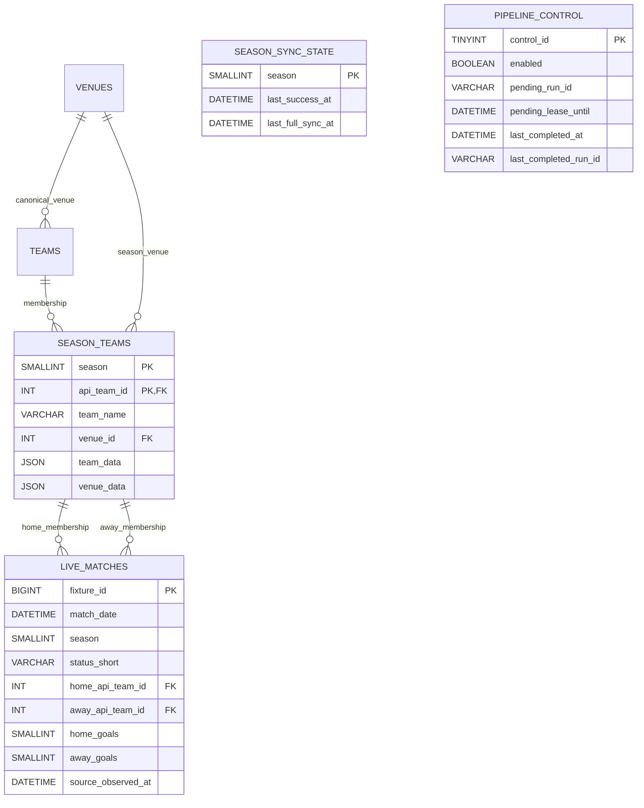

# Premier League Data Engineering Pipeline — Data Model

## Seasons and identities

The existing tables are preserved. Migration 003 adds match metadata and three supporting tables. `2024` means 2024–25; `2026` means 2026–27. Never infer season by taking the calendar year of a kickoff date.



## `live_matches`

Existing columns retain their meanings:

| Column | Type after migration | Meaning |
| --- | --- | --- |
| `fixture_id` | BIGINT UNSIGNED, primary key | Stable source identity across corrections and postponements |
| `match_date` | DATETIME(6), nullable | UTC kickoff, without timezone offset; nullable for TBD/PST |
| `home_team`, `away_team` | VARCHAR(100), required | Source team-name snapshots |
| `home_goals`, `away_goals` | SMALLINT UNSIGNED, nullable | Null before scores are known; never fabricate zero |

Added metadata:

| Column | Type | Meaning |
| --- | --- | --- |
| `season` | SMALLINT UNSIGNED, nullable for migration compatibility | Starting year; required by new application writes |
| `status_short` | VARCHAR(5) | API status code |
| `status_long` | VARCHAR(100) | Human-readable source status |
| `elapsed` | SMALLINT UNSIGNED, nullable | Source elapsed match time |
| `home_api_team_id`, `away_api_team_id` | INT UNSIGNED, nullable for migration compatibility | Source team IDs; required by new writes |
| `source_observed_at` | DATETIME(6), nullable for backfilled archive | UTC batch observation time, not an API updated-at timestamp |

The existing primary key, date/home/away unique key, and indexes are retained. A season/status/date index supports unresolved-fixture selection. Two foreign keys reference `(season, api_team_id)` in `season_teams`. The loader guards alternate-key collisions before UPSERT and never changes an existing fixture's season identity. A full load is not a replacement/delete operation.

Scheduled/live/postponed/abandoned/cancelled/technical outcomes retain appropriate nulls. Finished FT/AET/PEN require populated nonnegative integral scores. Unknown statuses or malformed dates fail before loading. The original 380 completed historical matches receive only metadata backfills; their original six data fields remain unchanged.

## `teams` and `venues`

The original schema in `sql/schema.sql` is unchanged. `teams.team_id` is an internal surrogate key; `api_team_id` is the unique source identifier. `teams.venue_id` still references `venues.venue_id`. These original rows preserve the historical canonical descriptions.

Phase 2 inserts previously unseen source IDs without overwriting existing descriptions. Global table counts can exceed 20 as seasons introduce new clubs and venues. Current-season descriptions must be read from `season_teams`, rather than assuming canonical rows describe every later season.

## `season_teams`

The composite primary key is `(season, api_team_id)`. Its foreign keys reference the canonical source team ID and optional venue. `team_name` and `venue_id` make current membership easy to query. `team_data` and `venue_data` preserve the normalized metadata returned for that season, including current stadium details. Missing venues are represented as null; referentially missing non-null venue IDs fail loading.

Migration 003 seeds the 20 historical memberships and their descriptions. Each configured active season must have 20 memberships; there is no global 20-team constraint. Membership updates do not delete old seasons.

Example season-aware query:

```sql
SELECT m.season, h.team_name AS home_team, a.team_name AS away_team,
       m.match_date, m.status_short, m.home_goals, m.away_goals
FROM live_matches AS m
JOIN season_teams AS h
  ON h.season=m.season AND h.api_team_id=m.home_api_team_id
JOIN season_teams AS a
  ON a.season=m.season AND a.api_team_id=m.away_api_team_id
WHERE m.season=2026
ORDER BY m.match_date;
```

## `season_sync_state`

One row per successfully refreshed season stores `last_success_at` and `last_full_sync_at`. Extraction reads these checkpoints to select a window versus a full reconciliation. They advance only in the successful final quality transaction. An empty incremental window can advance success time while retaining the previous full-sync timestamp. The archived season need not have a sync-state row because it is never automatically refreshed.

## `pipeline_control`

The singleton row `control_id=1` enables/disables Phase 2, records the pending run owner, and remembers the last completed run ID/time. Short transactions lock this row to enforce one pipeline owner across local and Airflow runs. A failed run retains ownership until resumed, explicitly released, or its six-hour lease expires and a new extraction takes ownership. Superseded workers cannot write. The final validation/checkpoint operation is safe to retry after commit.

## Historical integrity and migrations

Validation compares every original fixture/date/name/score tuple and every original canonical team/venue row against the committed CSVs, not merely a count of 380. New season records do not replace or delete historical rows. The trusted CSV files are mounted read-only in Docker and never used as incremental staging targets.

Migration 003 is explicit and guarded. It preflights the exact archive before DDL, supports resuming an interrupted up migration, and permits schema rollback only before incremental ingestion. After new seasons are loaded, rollback refuses to discard their metadata or rows; stop the scheduler and retain the additive schema instead. See [migration and recovery instructions](phase2-migrations.md).
