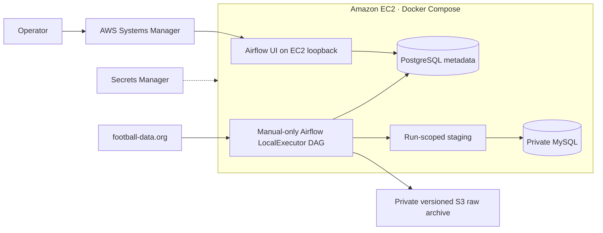

# Premier League Data Pipeline — AWS demo evidence

Verified on November 11, 2026 UTC. This evidence records a real, time-boxed
AWS deployment, the first supervised ingestion, and one supervised repeat-run
idempotency check.



## Deployment and capacity

| Evidence | Verified result |
|---|---|
| CloudFormation | `CREATE_COMPLETE`, all 14 reviewed resources created |
| EC2 and storage | Ohio, Linux x86 `c7i-flex.large`, 2 vCPU, 4 GiB nominal RAM, 20 GiB encrypted gp3. Instance, system and EBS checks passed. |
| Containers | MySQL 8.4, PostgreSQL 16, Airflow 3.3.1 API, DAG processor and LocalExecutor scheduler healthy after the run |
| Observed workload | Peak host memory use about 2,008 MiB; minimum available RAM 1,808 MiB; minimum free disk 14,151 MiB. All five containers remained healthy with zero OOM kills and zero restarts. |
| DAG | `premier_league_demo`, exactly five tasks, `schedule=None`, paused after the run, no next scheduled run |
| Host cutoff and final state | November 12, 2026 at 07:45 UTC; not extended. EC2 `i-096dc75f42aa9b564` was verified `stopped` in `us-east-2`. No other EC2 instances were running. |

The DAG imported the original five-task chain:

```text
extract_matches → extract_teams_and_venues → load_teams_and_venues
→ load_matches → validate_data_quality
```

## Cloud data baseline

| Check | Verified result |
|---|---|
| 2024–25 archive | 380 fixtures. Historical fixture, team and venue values matched the committed archive. |
| 2026–27 | 380 fixtures loaded: 100 finished and 280 scheduled; 380 unique fixture IDs. All 380 were new inserts; no rows were updated, skipped, or rejected. |
| Historical archive | The exact 380-row 2024 snapshot and historical team/venue values still match the committed archive after ingestion. |
| Provider registry | 20 football-data.org team mappings and 380 football-data.org fixture mappings for 2026; the 2024 API-FOOTBALL mappings remain separate. Registry validation passed. |
| Schema | Eight foreign keys. MySQL application connection negotiated TLS. |
| Checkpoint | The 2026 full-sync success checkpoint advanced after validation at `2026-11-11 05:23:25 UTC`; no pending run remains. |
| S3 | Two versioned raw objects verified for the successful run: 450,530 bytes total (matches: 380 fixtures; teams: 20 teams). SSE-S3 and SHA-256 content checks passed. Bucket public access block and TLS-only policy remain enabled. |
| Secrets and network | The provider token is held in the existing Secrets Manager secret and root-only runtime configuration. Temporary HTTPS egress was limited to resolved football-data.org and regional S3 addresses, then removed. The DAG is paused and its S3 write role remains scoped to `raw/*`. |
| Run history | The initial approved run failed before the provider request because the staging volume lacked an application-writable directory. The fix was limited to `/opt/soccer/data/staging` (`50000:0`, mode `0750`); the approved retry then passed all five tasks once. |
| Network | Zero EC2 ingress, SSM operator access, loopback-only UI and internal database networks |

## Repeat-run idempotency evidence

Exactly one approved manual repeat ran over the normal incremental window
(`2026-10-28` through `2026-11-25`). All five Airflow tasks passed, and the DAG
was paused again after the run. The extractor returned 30 fixtures and 20
teams. All 30 fixture keys already existed: zero new fixture rows, zero
duplicate keys, zero provider-mapping collisions, zero rejected records, and
zero business-value changes. The database remained at 760 fixtures total:
380 historical and 380 current-season. Exact pre/post fingerprints for
fixture business fields, teams, provider mappings and season bindings matched.

The 2026 checkpoint advanced only after validation to
`2026-11-11 05:35:04 UTC`; its full-sync timestamp remained
`2026-11-11 05:23:25 UTC`. The pending-run field is empty. The repeat archived
two SSE-S3 protected objects (matches and teams), totaling 109,568 bytes;
object contents matched the run response digests. The earlier first-ingestion
archive remains present (two objects, 450,530 bytes).

At the repeat's observed peak, host memory use was about 2,008 MiB, minimum
available RAM was about 1,808 MiB, and minimum free disk was about 14,153 MiB.
All five containers stayed healthy with zero OOM kills and zero unexpected
restarts. The original egress restriction was restored, the DAG is paused, and
no active ingestion remains.

## Test and cost evidence

The complete local automated suite now passes: **327 passed, zero failures,
zero errors, and zero skips**. The suite ran against a fresh disposable MySQL
9.3 server listening on a Unix socket only, with TCP networking disabled; its
random `pl_test_*` schemas were isolated from the production database. The
isolated development environment now installs `cryptography` through the AWS
development requirements. Coverage includes extraction with mocked APIs,
incremental updates, multi-season constraints, idempotency, S3 conditional
archive writes, demo initialization, and simulated timer decisions. Airflow
3.3.1 imported the manual-only DAG both locally and in the demo image.
CloudFormation lint and Docker Compose validation passed. Hosted CI for this
branch is pending publication. A staging-permissions regression test now
checks the exact directory mode, application write access, non-recursive
behavior and least-privilege container settings.

The modeled gross cost is **$5.15** for 32 hours of EC2 and IPv4 plus one month
of modeled storage and secret usage. The latest AWS Budgets and Cost Explorer
readings showed $0.00 against the $10 monthly budget, but billing data can lag;
this is not a final invoice. The account previously showed $120 in credits.
The encrypted disk, bucket and secret can accrue charges after stopping EC2.

## Evidence still to collect

GitHub Actions remains pending publication. The CloudFormation stack, EBS
volume, S3 archive and Secrets Manager secret are retained; deletion requires
separate approval. The instance is stopped, which ends compute and its
auto-assigned IPv4 charges, but retained storage and the secret may continue
to accrue charges. This directory contains sanitized summaries and a diagram.
Keep credentials, raw command output, internal network addresses, database
dumps and console screenshots out of it.
