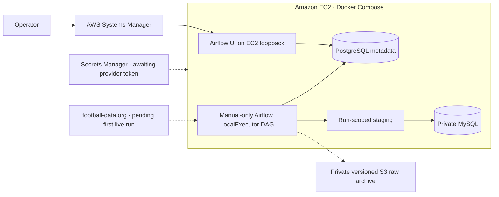

# Premier League Data Pipeline — AWS demo evidence

Verified on November 11, 2026 UTC. This evidence records a real, time-boxed
AWS deployment and its pre-ingestion baseline.



## Deployment and capacity

| Evidence | Verified result |
|---|---|
| CloudFormation | `CREATE_COMPLETE`, all 14 reviewed resources created |
| EC2 and storage | Ohio, Linux x86 `c7i-flex.large`, 2 vCPU, 4 GiB nominal RAM, 20 GiB encrypted gp3. Instance, system and EBS checks passed. |
| Containers | MySQL 8.4, PostgreSQL 16, Airflow 3.3.1 API, DAG processor and LocalExecutor scheduler all healthy |
| Observed steady state | 2,101 MiB available host RAM and about 14 GiB free disk. Docker reported about 953 MiB across the five containers, with zero OOM kills and zero recorded restarts. These are idle readings. |
| DAG | `premier_league_demo`, manual-only, paused, no next scheduled run and zero run records |
| Host cutoff | November 12, 2026 at 07:45 UTC. SSM confirmed the 15-second timer was active and firing. Live EC2 stop verification remains pending. |

The DAG imported the original five-task chain:

```text
extract_matches → extract_teams_and_venues → load_teams_and_venues
→ load_matches → validate_data_quality
```

## Cloud data baseline

| Check | Verified result |
|---|---|
| 2024–25 archive | 380 fixtures. Historical fixture, team and venue values matched the committed archive. |
| 2026–27 | No cloud rows at baseline. football-data.org configured for `season=2026`. |
| Provider registry | 20 historical team mappings and 380 historical fixture mappings for API-FOOTBALL. Registry validation passed. |
| Schema | Eight foreign keys. MySQL application connection negotiated TLS. |
| Checkpoint | Enabled, no active owner, no completed cloud run |
| S3 | Bucket versioning, SSE-S3, public access block, TLS-only policy and conditional writes verified. No raw object versions at baseline. |
| Secrets | Demo runtime secret exists. Its provider credential is pending. Scheduler external egress is blocked at baseline. |
| Network | Zero EC2 ingress, SSM operator access, loopback-only UI and internal database networks |

## Test and cost evidence

The local suite passed **326 tests with zero skips** using an isolated,
socket-only MySQL server. Coverage includes extraction with mocked APIs,
incremental updates, multi-season constraints, idempotency, S3 conditional
archive writes, demo initialization, and simulated timer decisions. Airflow
3.3.1 imported the manual-only DAG both locally and in the demo image.
CloudFormation lint and Docker Compose validation passed. Hosted CI for this
branch is pending publication.

The modeled gross cost is **$5.15** for 32 hours of EC2 and IPv4 plus one month
of modeled storage and secret usage. At verification, AWS Budgets reported
$0.00 against the $10 monthly budget and AWS reported $120 in credits.
Billing data can lag. The encrypted disk, bucket and secret can accrue
charges after stopping EC2.

## Evidence still to collect

The first cloud run, repeat-run comparison, production-source fixture
counts, S3 object digests, ingestion peak memory and disk, GitHub Actions,
and actual EC2 stop remain pending. This directory contains sanitized
summaries and a diagram. Keep credentials, raw command output, internal
network addresses, database dumps and console screenshots out of it.
